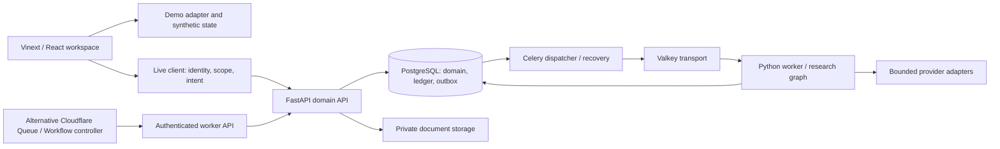

# BuyerOS architecture

This is a map of the checked-in implementation, not a production topology attestation.
Historical proposals and runtime evidence live under `docs/buyeros/`.

## Components and authority

The two execution transports are alternatives selected by runtime configuration,
not permission to dispatch one job through both. See
[`execution/`](services/api/buyeros_api/execution/),
[`worker_execution.py`](services/api/buyeros_api/services/worker_execution.py) and
[`worker_recovery.py`](services/api/buyeros_api/services/worker_recovery.py).

| Boundary | Implementation and invariant |
| --- | --- |
| Routes and state | `app/`, `features/workspace.tsx`, `features/live/`, `features/providers/`. Demo fixtures in `data/demo/` are distinct from live reads and writes. |
| Browser identity | `lib/auth/public-auth.ts` selects Auth0 or Neon explicitly. Neon cookie routes are server-owned; live API bearer tokens remain in memory. `SessionScope` aborts old work and increments a generation, rejecting late A→B→A results. |
| Typed HTTP | `services/live/operations.ts` combines generated routes/types with captured scope, bearer auth, idempotency keys and version preconditions. Client guards improve recovery; the API remains the authorization authority. |
| Domain API | `services/api/buyeros_api/api/app.py` registers routes; `services/` holds business rules. Current DB memberships and tenant scope authorize each operation, including retries. |
| Data | SQLAlchemy models, PostgreSQL RLS and tenant keys; Alembic owns domain migrations. Runtime roles and migration ownership are separate. Root `db/` and `drizzle/` are starter examples. |
| Durable work | Commit command, reservation/job and outbox before acknowledging admission. Dispatcher publishes IDs; workers recover/deduplicate with leases/fencing. Broker messages alone are not durable business truth. |
| Research | `run_admission.py`, `run_search.py`, `run_model.py` and the worker graph bound work and retain provenance. API-backed progress uses committed event sequence, SSE with polling fallback, duplicate rejection and snapshot recovery on a gap. |
| Money and provider uncertainty | `budget_service.py`, `provider_op.py`, `settlement.py` and contact/delivery services own reservations and reconciliation. A lost response is not proof an external operation failed; unknown outcomes cannot justify a fresh paid submission. |
| Documents | Upload/ingestion services validate and persist private sources through `object_store.py`; parser work belongs outside the browser. `PRIVATE_DOCUMENT_STORAGE.md` describes the storage options. |
| Drafts and approval | Immutable revisions and exact approval context bind recipient, evidence, sender, policy and content. Editing invalidates approval. Recovery text is never an approval or delivery grant. |

## Core journey and failure behavior

1. Save a project/offer and an immutable approved buyer-profile revision.
2. Admit bounded research with an idempotency key; persist the job and outbox.
3. Execute discovery/fit work, persist evidence and committed events, then review buyers.
4. Quote contact lookup separately; confirmation rechecks eligibility and budget.
5. Generate/save a grounded draft. Approval/export/delivery have separate contracts and gates.

[`tests/e2e/core-isolated.spec.ts`](tests/e2e/core-isolated.spec.ts) exercises the
requirement → research → results → saved **unsent** draft with deterministic providers.
[`test_core_flow_scope_db.py`](services/api/tests/test_core_flow_scope_db.py) checks
existing foreign resources and revoked-member replays against real fixture PostgreSQL.
The fast [`core tests`](docs/DEVELOPMENT.md#verification-ladder) pin client behavior
without claiming HTTP/DB/provider integration.

An ambiguous research acknowledgement retains the normalized payload and original
intent key. Edited requests require explicit reconciliation/reset. Run events must
match workspace/run and advance the cursor; a sequence gap reloads committed state.
Draft recovery is scoped by actor/workspace/project/draft, validates stored text and
returns copies. Restoring text still requires authenticated server read/version review.

## Risk map

| Risk | Impact | Existing controls / remaining exposure |
| --- | --- | --- |
| Tenant or stale-session data crossing scopes | High: disclosure or unauthorized writes | API membership/RLS, client generations and foreign-resource tests. Real identity plus pooled-role behavior must be verified for each deployed target. |
| Duplicate paid operations or unbounded unknown outcomes | High: spend and reconciliation errors | Durable intent keys, reservations, outbox and provider operation records. Transport recovery is distinct from vendor acceptance evidence. |
| Approval used after content/policy changes | High: unintended outreach | Immutable revisions and exact-context fingerprints; dedicated delivery gates. Draft recovery never restores approval. |
| Runtime and migration drift | High: incompatible API/worker/schema | Single Alembic owner, schema readiness and protected promotion controls. Render proposal still pins an older branch; transport/candidate identity needs explicit reconciliation before release. |
| Private document/draft retention and restore | High: retained sensitive data | Validated recovery buffers, private storage, retention and erasure tests. External object deletion/journal custody and restored backups need operational evidence. |
| Fragmented test entrypoints and historical status | Medium: checks omitted or mistaken for live proof | CI has discovery/JUnit guards; `test:core` adds a small named suite. Many bespoke commands and old evidence tables still require maintenance. |

## Next three engineering investments

1. **One reproducible owned-stack test entrypoint.** Consolidate API/worker/browser
   fixture allocation, identity receipts, named discovery and exact cleanup. Run the
   requirement-to-unsent-draft journey as a required PR check. Success: one documented
   command, no inherited targets, zero skipped cases, DB readback and retained receipts.
2. **Reconcile and rehearse one release topology.** Bind app/API/worker or controller,
   schema head and auth issuer to one source SHA. Rehearse staged promotion, rollback
   and provider-unknown recovery using the existing protected workflows. Success:
   one candidate receipt proves the complete dependency set and rollback readback.
3. **Operationalize reconciliation and retention.** Add actionable alerts for outbox
   age, stale leases, unresolved provider operations, ledger mismatch and retention
   backlog; rehearse restore plus erasure replay. Success: injected failures produce
   alerts and a documented operator resolution without duplicate submission or data revival.
